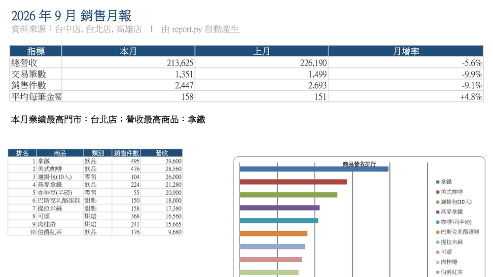
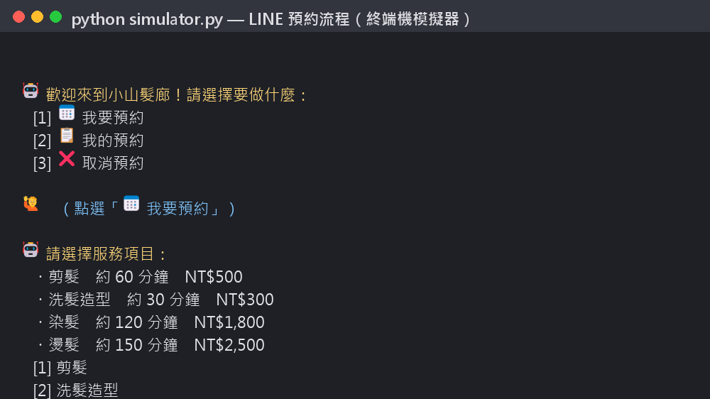
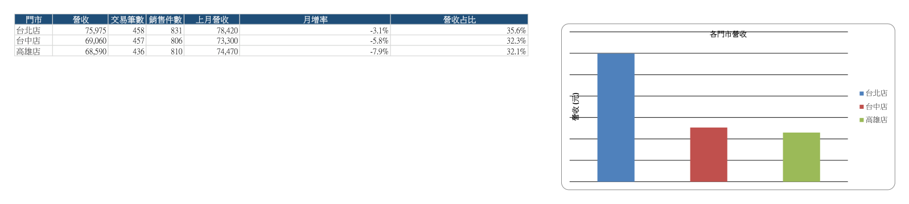
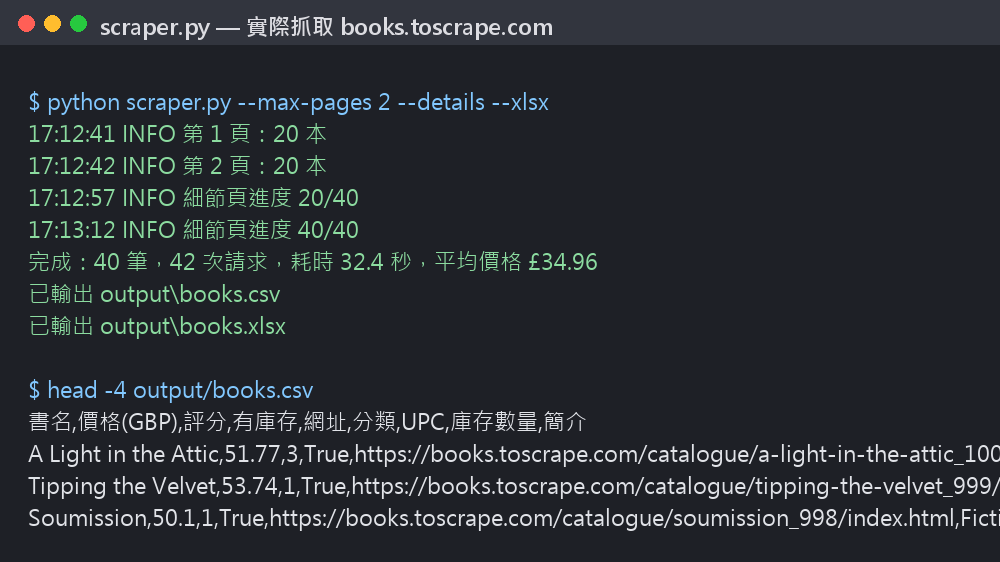

<div align="center">

# 自動化作品集

**把每天、每月重複做的手工作業，交給程式。**

整理 Excel 報表 · 蒐集網站資料 · 用 LINE 自動接預約

[](#快速試用)
[](#測試)
[](https://www.tasker.com.tw/workroom/gino-lab)
[](mailto:0311gino@gmail.com)

<br>

<table>
  <tr>
    <th width="33%"><a href="excel-auto-report/">📊 Excel 自動月報</a></th>
    <th width="33%"><a href="scraper-to-csv/">🕷️ 網站資料爬蟲</a></th>
    <th width="33%"><a href="line-booking-bot/">💬 LINE 預約機器人</a></th>
  </tr>
  <tr>
    <td><a href="excel-auto-report/"></a></td>
    <td><a href="scraper-to-csv/"></a></td>
    <td><a href="line-booking-bot/"></a></td>
  </tr>
  <tr>
    <td align="center">合併多間門市格式不一的檔案<br>→ 含圖表的月報</td>
    <td align="center">自動翻頁、進細節頁<br>→ Excel 可直接開的 CSV</td>
    <td align="center">客人點按鈕預約、查詢、取消<br>→ 店家即時收到通知</td>
  </tr>
</table>

三個作品都能直接下載執行，各附自動化測試與範例輸出。

</div>

<br>

## 作品

<table>
  <tr>
    <td width="46%" valign="top">
      <a href="excel-auto-report/"></a>
    </td>
    <td valign="top">
      <h3><a href="excel-auto-report/">📊 Excel 自動月報</a></h3>
      <p><b>客戶的痛點</b><br>各分店寄來的 Excel 欄位名稱、日期格式、數量寫法都不一樣，每個月要花半天複製貼上、對數字。</p>
      <p><b>做了什麼</b><br>一行指令合併所有檔案，自動修正重複列、壞日期、「3個」這類寫法、空白單價，產出 6 張工作表與 3 張圖表的月報。另附一張「清理紀錄」，每一筆被修正的資料都查得到。</p>
      <p><b>驗證</b><br>4,276 筆資料實跑、6 個測試通過。<a href="excel-auto-report/examples/銷售月報_2026-09.xlsx">下載範例報表 .xlsx</a></p>
      <p><code>pandas</code> <code>openpyxl</code></p>
    </td>
  </tr>
</table>

<table>
  <tr>
    <td width="46%" valign="top">
      <a href="scraper-to-csv/"></a>
    </td>
    <td valign="top">
      <h3><a href="scraper-to-csv/">🕷️ 網站資料爬蟲</a></h3>
      <p><b>客戶的痛點</b><br>要定期整理競品價格、商品清單、公開名錄，卻還在手動一頁一頁複製。</p>
      <p><b>做了什麼</b><br>自動翻頁、進入每個商品的細節頁，清理價格與評分後輸出 CSV（Excel 直接開啟不亂碼）。遵守 robots.txt、每次請求間隔、失敗自動重試。換網站只要改兩個解析函式。</p>
      <p><b>驗證</b><br>對練習網站實際抓取 40 筆含細節頁、9 個離線測試通過。<a href="scraper-to-csv/examples/books_sample.csv">下載範例 .csv</a></p>
      <p><code>requests</code> <code>BeautifulSoup</code></p>
    </td>
  </tr>
</table>

<table>
  <tr>
    <td width="46%" valign="top">
      <a href="line-booking-bot/"></a>
    </td>
    <td valign="top">
      <h3><a href="line-booking-bot/">💬 LINE 預約機器人</a></h3>
      <p><b>客戶的痛點</b><br>髮廊、美甲、診所、工作室的店家，每天一則一則回訊息排時間。</p>
      <p><b>做了什麼</b><br>客人在 LINE 點按鈕選服務、日期、時段就完成預約，也能查詢、取消。依營業時間、公休日、服務時長、人手自動算出空檔，兩人同時搶同一時段只會有一人成功。新預約或取消時店家立刻收到通知。</p>
      <p><b>驗證</b><br>18 個測試通過（含併發搶位、竄改資料、webhook 簽章）；附終端機模擬器，不需 LINE 帳號即可試玩。<a href="line-booking-bot/examples/demo-conversation.txt">完整對話紀錄</a></p>
      <p><code>Flask</code> <code>LINE Messaging API</code> <code>SQLite</code></p>
    </td>
  </tr>
</table>

## 快速試用

```bash
pip install -r excel-auto-report/requirements.txt -r scraper-to-csv/requirements.txt -r line-booking-bot/requirements.txt

cd excel-auto-report && python make_sample_data.py && python report.py "data/*.xlsx"
cd ../scraper-to-csv  && python scraper.py --max-pages 2
cd ../line-booking-bot && python simulator.py
```

## 測試

```bash
pip install -r requirements-dev.txt
python -m pytest excel-auto-report/tests scraper-to-csv/tests line-booking-bot/tests
```

共 33 個測試：Excel 6 · 爬蟲 9 · LINE bot 18。

## 合作方式

| 步驟 | 內容 |
|:--:|---|
| 1️⃣ 確認需求 | 免費討論，確認要處理的資料、要產出的格式、交期 |
| 2️⃣ 固定報價 | 先收 30% 訂金，交件驗收後付尾款 |
| 3️⃣ 交付 | 原始碼、使用說明、自動化測試；需要的話協助部署與教學 |
| 4️⃣ 保固 | 交件後 14 天內，免費修正原始需求範圍內的錯誤 |

開發時使用 AI 輔助工具（Claude Code）加快速度；每一份交付的程式都經過我自己檢查，並附上測試。

## 關於我

中央大學資工系，目前在國泰金控做區塊鏈技術開發實習。曾任臺中市教育局高中 AI 營隊講師，習慣把技術講到非工程師也聽得懂。

<div align="center">

**出任務 Tasker** [tasker.com.tw/workroom/gino-lab](https://www.tasker.com.tw/workroom/gino-lab) · **GitHub** [@ChiJiun](https://github.com/ChiJiun) · **Email** [0311gino@gmail.com](mailto:0311gino@gmail.com)

<sub>Python · pandas · openpyxl · requests · BeautifulSoup · Flask · LINE Messaging API · SQLite · pytest</sub>

</div>
